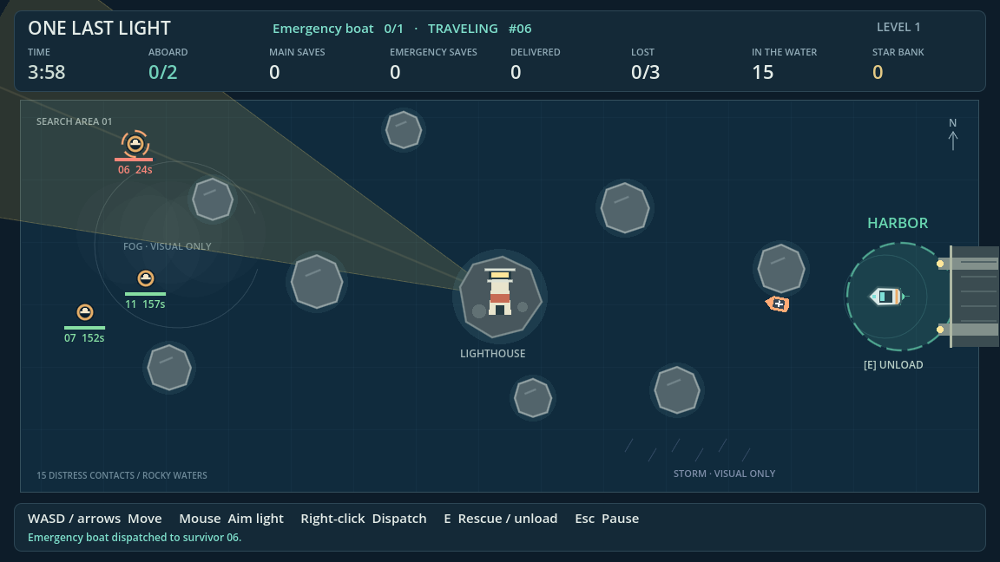

# One Last Light — Graybox v0.2

A playable 2D rescue strategy level for Game Production and Management, WS 2026/27. Steer the main boat while aiming the central lighthouse with the mouse. The far side of the chart takes time to reach. Sending the emergency boat there can save a life while you collect closer survivors, at the cost of the three stars you could have earned for that delivery.

## Open and play

1. Open this checkout on `feature/graybox-v0.2`, or extract the editable source archive.
2. In Godot **4.7.2 Standard**, import `project.godot` and press **F5**.
3. Select **Launch Rescue**. Both boats start in the harbor on the right. Level 1 starts with 15 live survivors and 4:00 on the clock.

The project uses GDScript, the Compatibility renderer and Godot's drawing primitives. The base viewport is 1152 × 648. All game content runs locally.

## Controls

| Input | Action |
| --- | --- |
| WASD or arrow keys | Steer the main boat. Release the keys to decelerate. |
| Mouse | Aim the lighthouse while steering. |
| E within 48 px of a live survivor | Pick up the closest person. This works even before discovery. |
| E in the harbor | Unload everyone aboard the main boat. |
| Right-click a visible survivor | Dispatch the emergency boat if it is ready. |
| Esc | Pause or resume the clock, oxygen, visibility memory, both boats and the emergency cooldown. |
| Left-click | Use launch, resume, upgrade and replay buttons. |

## Running a rescue

The beam reveals a survivor's ID, position, oxygen bar and seconds remaining. Moving within 64 px of someone also reveals them. A contact stays visible for three seconds after leaving both detection areas. Lighting the same spot again restores the indicator. Green means more than 55 seconds of oxygen, yellow means 31–55 seconds on the display and red means 30 seconds or less.

Oxygen runs from launch for everyone in the water. A successful pickup immediately freezes that person's oxygen. The main boat starts with two seats. Use the green harbor circle to unload, free both seats and earn **3 stars per person**. Steering into a rock or the island blocks the hull and briefly highlights its outline.

The orange emergency boat starts with one seat. Right-clicking a visible live contact reserves its destination and marks the target while visible. The boat can finish the trip after the contact fades. The player may still pick that person up first.

| Emergency status | Behavior |
| --- | --- |
| READY | Accepts one assignment. |
| TRAVELING | Follows a hull-clear route around rocks and the island. |
| RESCUING | Spends 0.65 seconds at the target. Oxygen continues until pickup succeeds. |
| RETURNING | Brings its passenger to harbor. If the target died or boarded the main boat, returns empty. |
| COOLDOWN | Waits 24 seconds after a successful delivery. An empty return becomes ready immediately. |

Emergency deliveries add one successful rescue and **zero stars**. Losses award zero stars. Only harbor deliveries enter the rescued count. The HUD shows the remaining time, both manifests, each boat's deliveries, total delivered, losses, people still in the water and the session star bank.

### Ending the level

- **Victory** requires all 15 people accounted for, with 13–15 delivered, at most two lost, and time left. A passenger still aboard either boat keeps the rescue open.
- **Game Over – Too Many Survivors Lost** appears on the third oxygen death.
- **Game Over – Time Ran Out** appears when the countdown expires with the rescue unfinished.

The results screen reports deliveries, losses, people still in the water and passengers still aboard. Between attempts, spend accumulated stars on **Main Boat Speed**. Each rank adds 18% of base speed. The three prices are **18, 27 and 36 stars**. Six personal deliveries fund the first rank. **Replay Level 1** restores positions, oxygen, visibility, both boats, cooldown and the clock. Banked stars and upgrades carry across attempts in the current application session.

## Design changes from v0.1

| System | v0.1 | v0.2 |
| --- | --- | --- |
| Search | Automatic rotating beam and permanent markers | Mouse aim, temporary visual memory and local detection |
| Survivors and boats | 10 contacts and a three-seat player boat | 15 different oxygen budgets, two player seats and a one-seat autonomous boat |
| Pickup | Required discovery | An in-range living survivor can board in darkness |
| Objective | Resolve the water contacts and unload | Four-minute deadline, immediate failure at three losses and a distinct victory |
| Economy | Personal deliveries, capacity and speed shop | Personal deliveries earn stars, emergency deliveries count toward victory, Level 1 speed shop |
| Progression | Increment the round number on the same map | Replay a single authored Level 1 with earned equipment |

The original project remains available at `graybox-v0.1`.

## Project structure and tuning

The editable level is `scenes/main.tscn`. It instances the existing boat, lighthouse, survivor, harbor and rock scenes alongside `scenes/emergency_boat.tscn`. `scripts/main.gd` connects input, HUD and screens. `game_manager.gd` coordinates the level, `level_clock.gd` tracks its deadline, and `rescue_economy.gd` handles the session bank and upgrade prices. The five survivor states are `ACTIVE`, `ON_MAIN_BOAT`, `ON_EMERGENCY_BOAT`, `DELIVERED` and `LOST`.

| Designer control | Default | Edit location |
| --- | --- | --- |
| Survivor position, ID and oxygen | 15 individual timers from 26 to 205 s | Survivor instances in `scenes/main.tscn` |
| Level duration, loss threshold, selection radius | 240 s, 3 losses, 22 px | GameManager exports in `scripts/game_manager.gd` |
| Main boat handling | 100 px/s, acceleration 300 and deceleration 240 px/s² | `scripts/player_boat.gd` |
| Main seats, pickup and proximity | 2, 48 px, 64 px | `scripts/player_boat.gd` |
| Lighthouse turning rate, range and full cone width | 6 rad/s, 660 px, 0.48 rad | `scripts/lighthouse.gd` |
| Visibility memory | 3 s | `visibility_memory_duration` in `scripts/survivor.gd` |
| Emergency seats, speed, pickup, service and cooldown | 1, 74 px/s, 22 px, 0.65 s, 24 s | `scripts/emergency_boat.gd` |
| Harbor delivery radius | 62 px | `scripts/harbor.gd` |
| Personal reward and speed prices | 3 stars, 18 initial price, 9 price increment, 3 ranks | GameManager's exported Economy resource |
| Speed improvement | 18% of base per rank | `speed_bonus_per_level` in `scripts/player_boat.gd` |

The northwest survivor has an early deadline. Eastern contacts give the player short trips while the emergency boat crosses the chart. Later oxygen budgets allow repeated returns from the west. The fixed-step route checks and remaining playtest questions are documented in [TESTING.md](TESTING.md).

The emergency boat first checks a direct route. For blocked passages, `scripts/boat_routes.gd` builds an AStar2D graph around the level's static colliders and tests segments with the actual hull. Both boats collide with level obstacles and can pass each other. Fog and storm marks are visual placeholders. Rocks do not occlude the beam.

Only Level 1 is playable. The economy records the planned unlock order for main speed, main capacity, lighthouse range, emergency speed, emergency capacity and emergency cooldown at levels 1–6 respectively. Later levels and their shops are future work. There is no disk save.

## Windows and editable source

Play directly in Godot on Windows. To build a standalone executable, install the matching 4.7.2 Standard export templates and use the included **Windows Desktop** x86_64 preset. To create an editable source ZIP, run `python tools/package_project.py` from the checkout. The tool writes `OneLastLight_Graybox_v0.2.zip` and its SHA-256 file beside the checkout. See [TESTING.md](TESTING.md) for the actual verification environment and commands.
