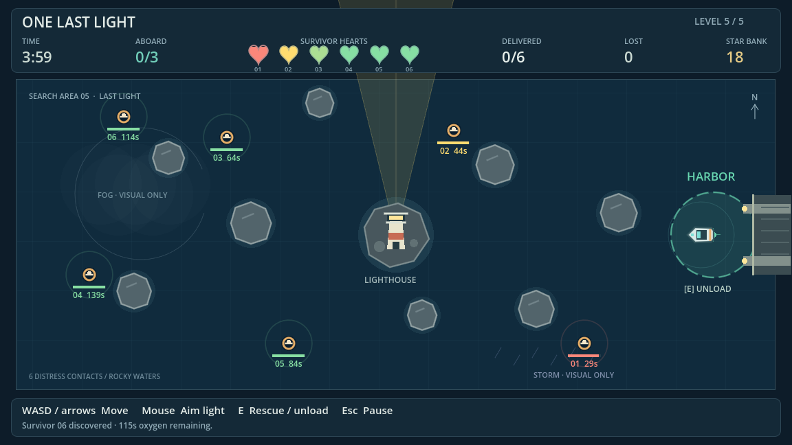

# One Last Light — Graybox v0.2

A playable 2D rescue strategy game for Game Production and Management, WS 2026/27, in five levels. You steer one boat while aiming the central lighthouse with the mouse. Find the survivors, carry them to the harbor before their oxygen runs out, and spend the stars you earn on boat upgrades.

## Open and play

1. Open this checkout on `feature/five-level-progression`, or extract the editable source archive.
2. In Godot **4.7.2 Standard**, import `project.godot` and press **F5**.
3. Read the four-step tutorial, moving with **Next** and **Back**, then select **Launch Rescue** on the last page. Nothing moves and the clock stays at 4:00 until you do.
4. A 3 → 2 → 1 countdown plays over the live scene while the white boat sails in from above the chart to the harbor on the right and the lighthouse beam points at the harbor. Controls, the timer and oxygen switch on together when the countdown ends. Every level, replay and campaign restart begins with the same countdown.

The project uses GDScript, the Compatibility renderer and Godot's drawing primitives. The base viewport is 1152 × 648. All game content runs locally.

## Controls

| Input | Action |
| --- | --- |
| WASD or arrow keys | Steer the boat. Release the keys to decelerate. |
| Mouse | Aim the lighthouse while steering. |
| E within 48 px of a live survivor | Pick up the closest person. This works even before discovery. |
| E in the harbor | Unload everyone aboard. |
| Esc | Pause or resume the clock, oxygen, visibility memory, boat and lighthouse. |
| Left-click | Use launch, upgrade, continue and replay buttons. |

## The five levels

Each level has its own survivors, positions and individual oxygen budgets, defined in a `LevelDefinition` resource (`resources/levels/level_1.tres` to `level_5.tres`). Only that level's survivors are created, and a level succeeds only when every one of them is **delivered to the harbor**. A survivor who is aboard is not yet delivered.

| Level | Title | Survivors | After the level |
| ---: | --- | ---: | --- |
| 1 | First Light | 1 | Popup: capacity 1 → 2 for 3 stars, or NOT NOW |
| 2 | Two Signals | 2 | Popup: capacity +1 for 6 stars, or NOT NOW |
| 3 | Crossing Currents | 4 | Continue to Level 4. No upgrade is offered. |
| 4 | Rocky Waters | 5 | **Prepare for Level 5**: speed +18% for 9 stars *or* capacity +1 for 9 stars, or Keep My Stars |
| 5 | Last Light | 6 | **All five levels complete** summary |

The boat starts with **one seat**, so every level can be finished without a single upgrade by carrying one survivor per trip. Upgrades only make that faster. Level 1 shows a three-second "MOVE YOUR MOUSE" hint above the lighthouse, with a smaller line "Aim the lighthouse beam to find the survivor." It appears just after the GO! flash, never blocks input, fades out by itself, pauses with the game and is shown only in Level 1 (including a Level 1 replay).

### Survivors and oxygen

Positions are in open water, at least 40 px of clear water from any rock, the island or the chart edge (the balance suite enforces this and the closest is 42 px). Oxygen is in seconds and starts when the level starts. A successful pickup freezes that person's oxygen.

| Level | Survivor: position → oxygen |
| ---: | --- |
| 1 | #1 (215, 335) → 120 s |
| 2 | #1 (845, 205) → 30 s · #2 (380, 495) → 50 s |
| 3 | #1 (860, 425) → 30 s · #2 (680, 170) → 40 s · #3 (305, 175) → 85 s · #4 (330, 485) → 60 s |
| 4 | #1 (900, 200) → 25 s · #2 (720, 500) → 35 s · #3 (480, 240) → 55 s · #4 (150, 300) → 100 s · #5 (420, 500) → 75 s |
| 5 | #1 (850, 500) → 30 s · #2 (660, 190) → 45 s · #3 (330, 200) → 65 s · #4 (130, 400) → 140 s · #5 (420, 500) → 85 s · #6 (180, 170) → 115 s |

The budgets were derived from real route lengths and the boat's real speed (see [TESTING.md](TESTING.md)). Every level keeps the four-minute clock, which never binds a competent player: with no upgrades the slowest level takes about 107 seconds in the reference run. Oxygen is the real difficulty.

### Stars and upgrades

| Rule | Value |
| --- | --- |
| Stars per delivered survivor | 3 |
| Starting capacity | 1 seat (maximum 4) |
| Speed | +18% of base per rank (maximum 3 ranks) |
| Level 1 offer | capacity +1, **3 stars** |
| Level 2 offer | capacity +1, **6 stars** |
| Level 4 offer (for Level 5) | speed +18%, **9 stars**, or capacity +1, **9 stars**. Buying one locks the other. |

Stars earned in a level are paid out only when the level succeeds; a failed attempt earns nothing, so a level cannot be replayed for extra stars. The bank, capacity and speed carry through every later level and every replay. Each offer can be bought once. Declining never blocks progress. A declined first upgrade is not skipped: the Level 2 offer shows the real values (1 → 2 passengers) at its own price. **Restart Campaign** on the final screen resets stars, upgrades and totals. Prices and amounts are exported fields on the `UpgradeOffer` resources and the popup text always reads them from the live economy.

If you deliver everyone, the totals are 18 survivors rescued and 54 stars earned. The final screen lists total survivors rescued, total stars earned, the remaining bank, the upgrades bought and a victory message.

### Ending a level

- **Victory** when every survivor of the level is delivered.
- **Level N Failed — Survivor lost** the moment one survivor's oxygen runs out.
- **Level N Failed — Time ran out** when the countdown expires with the rescue unfinished, even if people are still aboard.

**Replay Level N** restores positions, oxygen, visibility, the boat and the clock, keeps the bank and every upgrade you own, and plays the countdown again.

## The top bar

TIME, ABOARD (passengers / seats), a row of **survivor hearts**, DELIVERED (n / level total), LOST and STAR BANK, plus the level number ("LEVEL 3 / 5"). There is one heart per survivor of the current level (1, 2, 4, 5 or 6), in ID order, rebuilt whenever a level loads. A heart in the water drains from the bottom as that survivor's oxygen runs out, shifting from green to yellow-orange at 55 seconds and red at 30, and only a red heart pulses. Boarding holds the fill and outlines the heart in teal. Delivery fills it solid teal with a check mark. A survivor lost to oxygen shows a dark cracked heart. Hearts are centered between ABOARD and DELIVERED at equal gaps, so one heart looks as tidy as six.

## Design history

| System | v0.1 | v0.2 (this branch) |
| --- | --- | --- |
| Search | Automatic rotating beam and permanent markers | Mouse aim, temporary visual memory and local detection |
| Levels | One map, round counter | Five authored, data-driven levels with 1, 2, 4, 5 and 6 survivors |
| Boats | Three-seat player boat | One boat that starts with one seat and is upgraded between levels |
| Pickup | Required discovery | An in-range living survivor can board in darkness |
| Economy | Capacity and speed shop after each round | 3 stars per delivery, three capacity offers and one exclusive speed/capacity choice |

The earlier two-boat design (an autonomous emergency boat dispatched by right-click) has been removed completely: no scene, script, HUD readout, tutorial text, input or test remains.

The original project remains available at `graybox-v0.1`.

## Project structure and tuning

The editable level is `scenes/main.tscn`. It instances the boat, lighthouse, harbor and rock scenes and has an empty `World/Survivors` node into which the manager spawns each level's survivors. `scripts/main.gd` builds the HUD and screens and forwards input. `game_manager.gd` loads levels, applies the win and fail rules and owns the campaign flow, `level_clock.gd` tracks the deadline and `rescue_economy.gd` holds stars, capacity, speed and purchases. `level_definition.gd`, `survivor_spec.gd` and `upgrade_offer.gd` are the three Resource types behind the level files, and `mouse_cue.gd` draws the Level 1 hint. The four survivor states are `ACTIVE`, `ON_BOAT`, `DELIVERED` and `LOST`.

| Designer control | Default | Edit location |
| --- | --- | --- |
| Survivors: id, position, oxygen | See the table above | `survivors` in each `resources/levels/level_N.tres` |
| Level duration, losses allowed, mouse cue, offer screen | 240 s, 0, Level 1 only, per level | The same level file |
| Upgrade offers: kind, cost, amount, exclusivity | See "Stars and upgrades" | `upgrade_offers` and `offers_exclusive` in the level file |
| Stars per survivor, starting and maximum capacity, maximum speed ranks | 3, 1, 4, 3 | Exported fields in `scripts/rescue_economy.gd` |
| Boat handling | 100 px/s, acceleration 300 and deceleration 240 px/s² | `scripts/player_boat.gd` |
| Pickup and proximity radius | 48 px, 64 px | `scripts/player_boat.gd` |
| Speed improvement | 18% of base per rank | `speed_bonus_per_level` in `scripts/player_boat.gd` |
| Lighthouse turning rate, range and full cone width | 6 rad/s, 660 px, 0.48 rad | `scripts/lighthouse.gd` |
| Visibility memory | 3 s | `visibility_memory_duration` in `scripts/survivor.gd` |
| Harbor delivery radius | 62 px | `scripts/harbor.gd` |
| Mouse cue duration and start delay | 3 s, 0.8 s after activation | `scripts/mouse_cue.gd`, set in `scripts/main.gd` |

After changing a level's survivors or oxygen, run `godot --headless --path . --fixed-fps 60 --script res://tests/balance_suite.gd`. It re-validates positions and plays every level with the real boat. `tests/tools/plan_report.gd` prints clearances, route lengths and suggested oxygen budgets while authoring a level.

Rocks and the island block the hull. Fog and storm marks are visual placeholders. Rocks do not occlude the beam. There is no disk save: stars and upgrades live for the current application session.

## Windows and editable source

Play directly in Godot on Windows. To build a standalone executable, install the matching 4.7.2 Standard export templates and use the included **Windows Desktop** x86_64 preset. To create an editable source ZIP, run `python tools/package_project.py` from the checkout. The tool writes `OneLastLight_Graybox_v0.2.zip` and its SHA-256 file beside the checkout. See [TESTING.md](TESTING.md) for the verification environment and commands.
